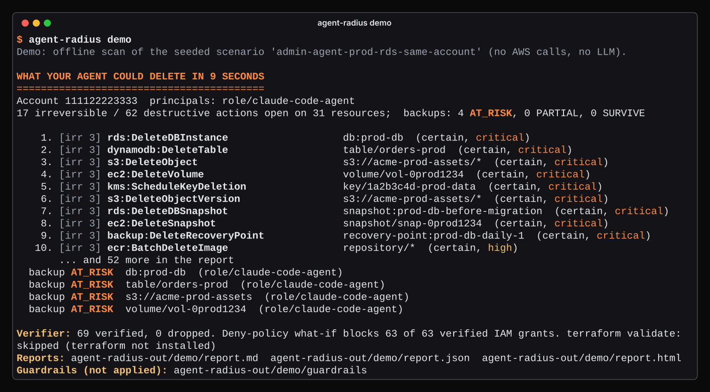
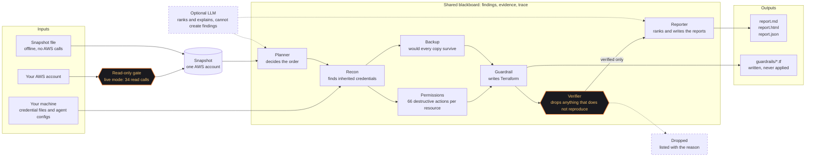
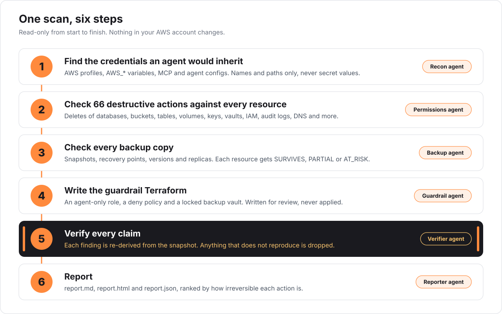
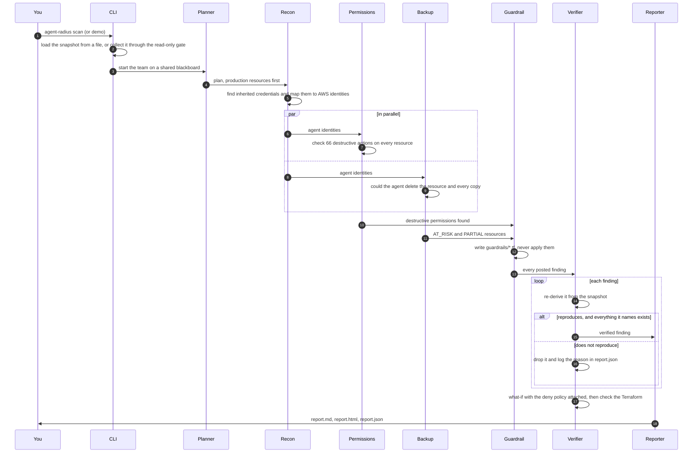

<p align="center">
  
</p>

<p align="center">
  <a href="LICENSE"></a>
  <a href="pyproject.toml"></a>
  <a href="tests"></a>
  <a href="SECURITY.md"></a>
  <a href="#try-it-in-60-seconds"></a>
</p>

**Agent Radius is a free, open-source tool that shows what an AI coding agent could destroy in your AWS account with the credentials it finds on your machine. It only reads. It never changes anything.**

> **What could my AI agent delete?**<br/>
> It finds the credentials an agent would pick up, then lists every destructive action they allow, resource by resource, most irreversible first.
>
> **Would my backups survive?**<br/>
> It checks every snapshot, recovery point, object version and replica, then marks each resource SURVIVES, PARTIAL or AT_RISK.
>
> **What closes the gap?**<br/>
> It writes the Terraform guardrail for you to review. It never applies it.

## Contents

- [Try it in 60 seconds](#try-it-in-60-seconds)
- [How it works](#how-it-works)
- [The flow, step by step](#the-flow-step-by-step)
- [What you get](#what-you-get)
- [Why you can trust the output](#why-you-can-trust-the-output)
- [Details for engineers](#details-for-engineers)
  - [Benchmark results](#benchmark-results)
  - [The 66 actions it checks](#the-actions-it-checks)
  - [Scan your own AWS account (read-only)](#scan-your-own-aws-account)
  - [Optional AI mode](#optional-ai-mode)
  - [What it does not do yet](#what-it-does-not-do-yet)
  - [FAQ](#faq)
- [Why this exists](#why-this-exists)

## Try it in 60 seconds

You need Python 3.11 or newer and [uv](https://docs.astral.sh/uv/). You do not need an AWS account, credentials or an API key.

```bash
git clone https://github.com/avinash-matrixgard/agent-radius.git && cd agent-radius
uv venv --python 3.11 .venv && uv pip install -e .
.venv/bin/agent-radius demo
```

The demo scans a built-in example account offline: an AI agent role with admin access, production data, and backups kept in the same account. This is the real output:

<p align="center">
  
</p>

<details>
<summary>The same output as text</summary>

```text
Demo: offline scan of the seeded scenario 'admin-agent-prod-rds-same-account' (no AWS calls, no LLM).

WHAT YOUR AGENT COULD DELETE IN 9 SECONDS
=========================================
Account 111122223333  principals: role/claude-code-agent
17 irreversible / 62 destructive actions open on 31 resources;  backups: 4 AT_RISK, 0 PARTIAL, 0 SURVIVE

    1. [irr 3] rds:DeleteDBInstance                   db:prod-db  (certain, critical)
    2. [irr 3] dynamodb:DeleteTable                   table/orders-prod  (certain, critical)
    3. [irr 3] s3:DeleteObject                        s3://acme-prod-assets/*  (certain, critical)
    4. [irr 3] ec2:DeleteVolume                       volume/vol-0prod1234  (certain, critical)
    5. [irr 3] kms:ScheduleKeyDeletion                key/1a2b3c4d-prod-data  (certain, critical)
    6. [irr 3] s3:DeleteObjectVersion                 s3://acme-prod-assets/*  (certain, critical)
    7. [irr 3] rds:DeleteDBSnapshot                   snapshot:prod-db-before-migration  (certain, critical)
    8. [irr 3] ec2:DeleteSnapshot                     snapshot/snap-0prod1234  (certain, critical)
    9. [irr 3] backup:DeleteRecoveryPoint             recovery-point:prod-db-daily-1  (certain, critical)
   10. [irr 3] ecr:BatchDeleteImage                   repository/*  (certain, high)
       ... and 52 more in the report
  backup AT_RISK  db:prod-db  (role/claude-code-agent)
  backup AT_RISK  table/orders-prod  (role/claude-code-agent)
  backup AT_RISK  s3://acme-prod-assets  (role/claude-code-agent)
  backup AT_RISK  volume/vol-0prod1234  (role/claude-code-agent)

Verifier: 69 verified, 0 dropped. Deny-policy what-if blocks 63 of 63 verified IAM grants. terraform validate: skipped (terraform not installed)
Reports: agent-radius-out/demo/report.md  agent-radius-out/demo/report.json  agent-radius-out/demo/report.html
Guardrails (not applied): agent-radius-out/demo/guardrails
```

</details>

How to read it:

- **`[irr 3]`** is the irreversibility score. 3 means the data is gone and cannot be restored from inside the account. 2 means destructive but recoverable if a backup survives. 1 means it weakens a protection, escalates privilege, or can be undone.
- **certain** means the policies allow it with no conditions attached. If a condition (such as "only with MFA") decides it, the report says **possible** instead.
- **AT_RISK** means the agent could delete the resource *and* every copy of it.
- **Verifier** is the step that re-checks every claim. Here it kept all 69 and dropped none.

Then open `agent-radius-out/demo/report.html` in a browser. Every finding cites the policy statements behind it, for example `managed:arn:aws:iam::aws:policy/AdministratorAccess#0`.

## How it works

<p align="center">
  
</p>

Agent Radius is a team of seven small agents. They share one **blackboard**: a common record that every agent reads from and writes to. Each agent has one job and a fixed set of read-only tools.

- The **snapshot** is a point-in-time copy of one AWS account: its IAM policies (who may do what), its resources and its backups. It is collected read-only, or loaded from a file.
- An agent cannot post a finding without **evidence**: the policy statement, resource or credential it is based on. The blackboard refuses it otherwise.
- Nothing reaches the report until the **Verifier** has re-derived it from the snapshot.

The same picture as an interactive diagram (GitHub draws Mermaid diagrams natively, with pan and zoom):



More depth: [docs/DESIGN.md](docs/DESIGN.md) covers the agents, the backup survivability model and the Verifier. [docs/IAM_SEMANTICS.md](docs/IAM_SEMANTICS.md) states exactly what the IAM evaluator models, and what it does not.

## The flow, step by step

<p align="center">
  
</p>

1. **Find the credentials an agent would inherit.** Recon looks where an agent process looks: AWS profiles, `AWS_*` environment variables, and MCP or agent config files. (MCP, the Model Context Protocol, is how coding agents plug into tools, and its config files can carry AWS keys.) It records names and paths, never secret values.
2. **Check 66 destructive actions against every resource.** For each identity the agent can use, Permissions asks an offline IAM evaluator: would AWS allow this action on this resource? The evaluator handles the parts of IAM that trip people up: `NotAction` and `NotResource`, permissions boundaries (a cap on what a role can ever do), service control policies or SCPs (a cap set for the whole AWS organization), and resource policies on S3 buckets, KMS keys and backup vaults.
3. **Check every backup copy.** Backup asks: could the agent delete the resource *and* every copy of it? It counts snapshots, recovery points, point-in-time recovery, object versions and replicas. It knows about deletion protection, Object Lock (S3's write-once setting), backup vault locks and copies kept in another account. It also catches two-step paths such as "rewrite the vault policy, then delete".
4. **Write the guardrail Terraform.** Guardrail writes an agent-only role with a permissions boundary, an explicit deny for every destructive action found, a compliance-locked backup vault in a separate account, and versioning plus Object Lock for Terraform state buckets. The files are written for you to review. They are never applied.
5. **Verify every claim.** The Verifier re-derives every finding from the snapshot. Anything that does not reproduce, or that names a policy, resource or identity that does not exist, is dropped and logged with the reason. It then attaches the generated deny policy in a what-if copy and checks again, to show what the guardrail would block.
6. **Report.** The Reporter ranks what is left, most irreversible first, and writes the report in three formats.

Who hands off to whom. Agents never call each other directly: each one reads the blackboard and posts to it, and the arrows show the order.



## What you get

Everything lands in one output folder (`agent-radius-out/` by default).

| File | What it is for |
|---|---|
| `report.html` | Open it in a browser. One page: what the agent could delete, ranked, then backup verdicts and the guardrail summary. |
| `report.md` | The same report as Markdown, for a pull request, a ticket or a wiki. |
| `report.json` | Everything, machine-readable: each finding with its evidence, what the Verifier dropped and why, and the full agent trace. Use it in CI. |
| `guardrails/agent_role.tf` | A dedicated agent role with a permissions boundary that forbids every catalogued irreversible action. |
| `guardrails/deny_destructive.tf` | An explicit deny for the destructive actions found in this scan, attached to the new agent role and to the identities the agent uses today. |
| `guardrails/backup_vault.tf` | A compliance-locked vault in a separate backup account, plus a plan that copies the at-risk resources there. |
| `guardrails/state_bucket.tf` | Versioning and Object Lock for the Terraform state bucket. |
| `guardrails/deny_policy.json` | The deny policy as plain JSON, to review or to use outside Terraform. |
| `guardrails/variables.tf`, `versions.tf`, `README.md` | Inputs with safe defaults, provider versions, and a note on what each file does. |
| `snapshot.json` | Live scans only. What was collected, so you can re-run the analysis offline. |

Guardrail files are written only when relevant: no state bucket found, no `state_bucket.tf`. The report itself runs in this order: the headline "What your agent could delete in 9 seconds" ranked by irreversibility, then backup verdicts, Terraform state, inherited credentials, the guardrail what-if, verification, coverage gaps and the agent trace.

## Why you can trust the output

- **Read-only, enforced in code.** Every AWS call goes through a gate with an explicit allowlist of read operations (live mode uses 34 of them). Anything that creates, changes, deletes or reads secret contents is refused before the request is signed. The gate checks twice: when the method is looked up, and again just before each request is sent.
- **A Verifier checks every claim.** Each finding is re-derived from the snapshot. If it does not reproduce, or names a policy, resource or identity that does not exist, it is dropped and the reason is logged.
- **Secrets are never stored or sent.** Recon keeps key names and file paths only. Access key IDs become salted fingerprints. Reports are scrubbed for anything that looks like a secret, and the Reporter refuses to write if one remains.
- **The LLM is optional and fenced.** It is off by default. When you turn it on, it can only reorder, rank and explain findings that are already verified. Its replies are checked against a schema, and any ARN (AWS's ID for a resource) or action it invents is stripped and logged.
- **Every line cites evidence.** Policy statement ids, resource ARNs and credential ids, all traceable in `report.json`.

The full security model, and how to report a vulnerability, is in [SECURITY.md](SECURITY.md).

## Details for engineers

Click a section to open it.

<a name="benchmark-results"></a>
<details>
<summary><b>Benchmark results</b></summary>

`agent-radius bench` runs every seeded scenario offline with `--llm none` and scores it against ground truth: expected findings that must appear, and must-not findings that must not (including "this secret string must not appear in any output file"). Results from our run, pasted verbatim:

```text
PASS  admin-agent-prod-rds-same-account            expected 8/8  must-not violated 0/2  hallucinations 0  reported 69
PASS  boundary-excludes-deletes                    expected 4/4  must-not violated 0/4  hallucinations 0  reported 10
PASS  bucket-policy-denies-deletebucket            expected 2/2  must-not violated 0/1  hallucinations 0  reported 12
PASS  cross-account-vault-lock                     expected 4/4  must-not violated 0/3  hallucinations 0  reported 71
PASS  dev-only-deletes                             expected 3/3  must-not violated 0/3  hallucinations 0  reported 13
PASS  dynamodb-pitr-off                            expected 3/3  must-not violated 0/1  hallucinations 0  reported 16
PASS  ebs-snapshots-mixed                          expected 3/3  must-not violated 0/2  hallucinations 0  reported 8
PASS  governance-vault-removable                   expected 2/2  must-not violated 0/1  hallucinations 0  reported 38
PASS  kms-schedule-key-deletion                    expected 2/2  must-not violated 0/2  hallucinations 0  reported 7
PASS  mcp-config-embedded-keys                     expected 4/4  must-not violated 0/5  hallucinations 0  reported 40
PASS  mfa-conditioned-delete                       expected 2/2  must-not violated 0/2  hallucinations 0  reported 4
PASS  notaction-trap                               expected 3/3  must-not violated 0/3  hallucinations 0  reported 36
PASS  privilege-escalation-self                    expected 2/2  must-not violated 0/2  hallucinations 0  reported 5
PASS  readonly-agent-scoped                        expected 2/2  must-not violated 0/4  hallucinations 0  reported 6
PASS  s3-object-lock-compliance                    expected 3/3  must-not violated 0/2  hallucinations 0  reported 24
PASS  scp-denies-rds-delete                        expected 2/2  must-not violated 0/2  hallucinations 0  reported 37
PASS  tfstate-unversioned                          expected 3/3  must-not violated 0/2  hallucinations 0  reported 15
PASS  vault-policy-deny-two-step                   expected 3/3  must-not violated 0/2  hallucinations 0  reported 46

scenarios 18/18 passed | precision 1.000 | recall 1.000 | TP 55 FN 0 FP 0 | hallucinations 0 | llm none
results written to bench/results.json
```

Read these numbers for what they are. We wrote the 18 scenarios alongside the engine, so 100% here shows the engine handles these known patterns and does not regress. It is regression coverage, not a measured accuracy on real accounts. Precision and recall are counted per ground-truth rule; hallucinations are reported findings that name a principal, action or resource absent from the snapshot or catalog, checked independently of the Verifier. During development the bench caught one real engine bug (a snapshot copied to another account was reported as deletable); we fixed the evaluator, not the expectation.

Scenarios cover: admin agent with same-account prod backups, a scoped read-only agent (false-positive test), cross-account copies with vault lock, an unversioned Terraform state bucket, a permissions boundary excluding deletes, an SCP denying `rds:Delete*`, `kms:ScheduleKeyDeletion` on the key encrypting prod data, a NotAction trap, an MFA-conditioned delete, DynamoDB with PITR off, S3 Object Lock in compliance mode, an MCP config embedding admin keys, a bucket policy denying DeleteBucket, dev-only deletes, mixed EBS snapshot locations, self privilege escalation, a removable governance vault lock, and a vault policy deny that only one of two agents can rewrite.

The test suite is offline too: `tmp_path` fixtures and moto (a local fake of the AWS APIs). Our run: `109 passed`.

</details>

<a name="the-actions-it-checks"></a>
<details>
<summary><b>The 66 actions it checks</b></summary>

Generated from the catalog in [`src/agent_radius/catalog/actions.py`](src/agent_radius/catalog/actions.py). Print it any time with `agent-radius catalog`.

- **Score** is irreversibility. **3**: data or evidence is gone and cannot be restored from inside the account (20 actions). **2**: destructive, but recoverable if a surviving backup or rebuild path exists (22). **1**: weakens a protection, escalates privilege, or is reversible (24).
- **Checked** says how. "each resource" means every matching resource in the snapshot is checked one by one (44 actions). "account-wide" means v1 checks one account-wide ARN instead, which answers "can the agent do this to every resource of this type" (22 actions).

<!-- generated from src/agent_radius/catalog/actions.py: 66 actions, 21 services -->
| Service | Action | Score | What it can do | Checked |
|---|---|:-:|---|---|
| **RDS** (7) | `rds:DeleteDBInstance` | 3 | Deletes the database; with SkipFinalSnapshot and no surviving snapshot the data is gone. | each resource |
|  | `rds:DeleteDBCluster` | 3 | Deletes the Aurora cluster and, by default, its automated backups. | each resource |
|  | `rds:DeleteDBSnapshot` | 3 | Deletes a manual database snapshot; there is no undo. | each resource |
|  | `rds:DeleteDBClusterSnapshot` | 3 | Deletes a manual cluster snapshot; there is no undo. | each resource |
|  | `rds:DeleteDBInstanceAutomatedBackup` | 3 | Deletes retained automated backups of a deleted instance. | account-wide |
|  | `rds:ModifyDBInstance` | 2 | Can turn off deletion protection or set backup retention to 0, which deletes automated backups. | each resource |
|  | `rds:ModifyDBCluster` | 2 | Can turn off deletion protection on the cluster or shorten backup retention. | each resource |
| **S3** (10) | `s3:DeleteBucket` | 2 | Deletes the bucket once empty; the name can then be claimed by anyone. | each resource |
|  | `s3:DeleteObject` | 3 | Permanently deletes objects in an unversioned bucket; adds delete markers in a versioned one. | each resource |
|  | `s3:DeleteObjectVersion` | 3 | Permanently deletes specific object versions, including the history versioning keeps. | each resource |
|  | `s3:BypassGovernanceRetention` | 2 | Lets deletes go through Object Lock governance-mode retention. | each resource |
|  | `s3:PutBucketVersioning` | 1 | Can suspend versioning so later deletes are permanent. | each resource |
|  | `s3:PutLifecycleConfiguration` | 2 | Can add an expiration rule that deletes every object and old version within a day. | each resource |
|  | `s3:PutBucketPolicy` | 1 | Can rewrite the bucket policy, removing deny guardrails or exposing data publicly. | each resource |
|  | `s3:DeleteBucketPolicy` | 1 | Removes the bucket policy and every deny guardrail in it. | each resource |
|  | `s3:PutBucketObjectLockConfiguration` | 1 | Can change default retention for new objects (cannot shorten compliance-mode locks already set). | each resource |
|  | `s3:PutReplicationConfiguration` | 1 | Can remove or redirect replication so new data stops reaching the copy. | each resource |
| **DynamoDB** (6) | `dynamodb:DeleteTable` | 3 | Deletes the table and every item in it. | each resource |
|  | `dynamodb:DeleteBackup` | 3 | Deletes on-demand backups, including the system backup kept after a PITR table is deleted. | each resource |
|  | `dynamodb:UpdateContinuousBackups` | 2 | Can turn off point-in-time recovery, discarding the restore window. | each resource |
|  | `dynamodb:UpdateTable` | 1 | Can turn off deletion protection on the table. | each resource |
|  | `dynamodb:DeleteItem` | 2 | Deletes items one by one; without PITR they cannot be restored. | each resource |
|  | `dynamodb:BatchWriteItem` | 2 | Deletes or overwrites up to 25 items per call. | each resource |
| **EC2 and EBS** (3) | `ec2:DeleteVolume` | 3 | Deletes the EBS volume and its data. | each resource |
|  | `ec2:DeleteSnapshot` | 3 | Deletes an EBS snapshot; there is no undo outside the Recycle Bin. | each resource |
|  | `ec2:TerminateInstances` | 2 | Terminates instances; instance-store data and delete-on-termination volumes are lost. | account-wide |
| **KMS** (5) | `kms:ScheduleKeyDeletion` | 3 | After the 7 to 30 day wait, every ciphertext under the key is unrecoverable, backups included. | each resource |
|  | `kms:DisableKey` | 1 | Makes all data encrypted under the key unreadable until the key is re-enabled. | each resource |
|  | `kms:PutKeyPolicy` | 2 | Can lock every other principal, including admins, out of the key. | each resource |
|  | `kms:DeleteImportedKeyMaterial` | 3 | Removes imported key material; data stays unreadable unless the same material is re-imported. | each resource |
|  | `kms:CreateGrant` | 1 | Can hand key permissions to another principal. | each resource |
| **AWS Backup** (7) | `backup:DeleteRecoveryPoint` | 3 | Deletes a backup recovery point; there is no undo. | each resource |
|  | `backup:UpdateRecoveryPointLifecycle` | 2 | Can shorten retention so recovery points expire early. | each resource |
|  | `backup:DeleteBackupVault` | 2 | Deletes an empty vault, along with its access policy and lock. | each resource |
|  | `backup:DeleteBackupVaultLockConfiguration` | 1 | Removes a governance-mode (or not yet immutable) vault lock. | each resource |
|  | `backup:PutBackupVaultAccessPolicy` | 1 | Can replace the vault policy and remove the deny that protects recovery points. | each resource |
|  | `backup:DeleteBackupVaultAccessPolicy` | 1 | Removes the vault access policy and every deny in it. | each resource |
|  | `backup:DeleteBackupPlan` | 1 | Stops future backups silently. | account-wide |
| **IAM** (10) | `iam:DeleteRole` | 2 | Deletes a role; workloads using it fail until it is recreated. | each resource |
|  | `iam:AttachRolePolicy` | 1 | Can attach AdministratorAccess to a role, including the agent's own. | each resource |
|  | `iam:PutRolePolicy` | 1 | Can write an inline policy granting anything to a role, including the agent's own. | each resource |
|  | `iam:UpdateAssumeRolePolicy` | 1 | Can let any principal, including outside accounts, assume the role. | each resource |
|  | `iam:DeleteRolePermissionsBoundary` | 1 | Removes the permissions boundary that caps a role. | each resource |
|  | `iam:CreateAccessKey` | 1 | Can mint long-lived access keys for another user. | each resource |
|  | `iam:AttachUserPolicy` | 1 | Can attach AdministratorAccess to a user. | each resource |
|  | `iam:PutUserPolicy` | 1 | Can write an inline policy granting anything to a user. | each resource |
|  | `iam:DeleteUser` | 2 | Deletes a user and every key and login it holds. | each resource |
|  | `iam:CreatePolicyVersion` | 1 | Can rewrite any customer managed policy, including the one that limits the agent. | account-wide |
| **Organizations** (1) | `organizations:LeaveOrganization` | 2 | Removes the account from the organization and every SCP guardrail with it. | account-wide |
| **EKS** (1) | `eks:DeleteCluster` | 2 | Deletes the Kubernetes control plane; workloads stop and cluster state is lost. | account-wide |
| **ECR** (2) | `ecr:DeleteRepository` | 3 | With force, deletes the repository and every image in it. | account-wide |
|  | `ecr:BatchDeleteImage` | 3 | Deletes container images; tags pointing at them break. | account-wide |
| **Lambda** (1) | `lambda:DeleteFunction` | 2 | Deletes the function and all its versions. | account-wide |
| **EFS** (1) | `elasticfilesystem:DeleteFileSystem` | 3 | Deletes the EFS file system and every file on it. | account-wide |
| **ElastiCache** (2) | `elasticache:DeleteCacheCluster` | 2 | Deletes the cache cluster and its in-memory data. | account-wide |
|  | `elasticache:DeleteReplicationGroup` | 2 | Deletes the replication group and its data. | account-wide |
| **Redshift** (1) | `redshift:DeleteCluster` | 3 | Deletes the warehouse; without a final snapshot the data is gone. | account-wide |
| **OpenSearch** (1) | `es:DeleteDomain` | 3 | Deletes the OpenSearch domain and its indices. | account-wide |
| **Secrets Manager** (1) | `secretsmanager:DeleteSecret` | 2 | With ForceDeleteWithoutRecovery the secret is gone immediately. | account-wide |
| **CloudWatch Logs** (1) | `logs:DeleteLogGroup` | 3 | Deletes the log group and all its events, including audit evidence. | account-wide |
| **CloudTrail** (2) | `cloudtrail:StopLogging` | 1 | Stops the audit trail so later actions leave no record. | account-wide |
|  | `cloudtrail:DeleteTrail` | 1 | Deletes the trail configuration. | account-wide |
| **GuardDuty** (1) | `guardduty:DeleteDetector` | 1 | Turns off threat detection and deletes its findings. | account-wide |
| **AWS Config** (1) | `config:DeleteConfigurationRecorder` | 1 | Stops AWS Config from recording resource changes. | account-wide |
| **Route 53** (2) | `route53:DeleteHostedZone` | 2 | Deletes the zone; a recreated zone gets new name servers, so the domain goes dark until delegation is fixed. | account-wide |
|  | `route53:ChangeResourceRecordSets` | 2 | Can delete or repoint DNS records for the whole domain. | account-wide |

</details>

<a name="scan-your-own-aws-account"></a>
<details>
<summary><b>Scan your own AWS account (read-only)</b></summary>

Use a read-only role to scan, and name the agent's role with `--principal`:

```bash
agent-radius scan --profile my-readonly-profile --region us-east-1 --out out/ \
  --principal arn:aws:iam::<account-id>:role/<your-agent-role>
```

- **Scan with read-only permissions.** For example, a role with the AWS managed `SecurityAudit` policy. Any operation the role cannot perform is recorded as a coverage gap instead of failing the scan. The gate means Agent Radius would not misuse broader credentials, but you should not have to trust that.
- **Before it calls anything**, live mode prints a read-only notice, the exact list of API operations it can call, and the local paths Recon will check.
- **Which identities it analyses.** The credentials Recon finds on the machine (each local profile is mapped with `sts:GetCallerIdentity`, through the same gate), plus any `--principal ARN` you pass. Only if neither yields an identity is the scanning identity itself analysed.
- **Re-run offline.** The collected snapshot is saved to `out/snapshot.json`. Scan it again with `agent-radius scan --fixture out/snapshot.json --out out2/`. The snapshot format mirrors `aws iam get-account-authorization-details` plus resource records; see `src/agent_radius/bench/scenarios/*/fixture.json` for examples.
- **Useful flags.** `--region` (repeatable, default `us-east-1`), `--fail-on high` exits 3 if any verified finding is at least that severe (for CI), `--recon-home DIR` scans a different home directory, `--no-terraform` skips `terraform validate`.

The complete list of AWS API operations live mode can call. All are `Get`, `List` or `Describe` style, each checked by the gate:

<!-- generated from LIVE_OPERATIONS in src/agent_radius/snapshot/collector.py: 34 operations -->
| Service | Operations |
|---|---|
| STS | `GetCallerIdentity` |
| IAM | `GetAccountAuthorizationDetails`, `ListAccessKeys` |
| Organizations | `DescribeOrganization`, `ListParents`, `ListPoliciesForTarget`, `DescribePolicy` |
| S3 | `ListBuckets`, `GetBucketLocation`, `GetBucketVersioning`, `GetObjectLockConfiguration`, `GetBucketPolicy`, `GetBucketReplication`, `GetBucketTagging`, `GetBucketEncryption` |
| RDS | `DescribeDBInstances`, `DescribeDBClusters`, `DescribeDBSnapshots`, `DescribeDBClusterSnapshots` |
| DynamoDB | `ListTables`, `DescribeTable`, `DescribeContinuousBackups`, `ListBackups`, `ListTagsOfResource` |
| EC2 | `DescribeVolumes`, `DescribeSnapshots` |
| KMS | `ListKeys`, `DescribeKey`, `GetKeyPolicy`, `ListResourceTags` |
| AWS Backup | `ListBackupVaults`, `GetBackupVaultAccessPolicy`, `ListRecoveryPointsByBackupVault`, `ListCopyJobs` |

The local paths Recon checks for credential presence (names and paths only, never values): `~/.aws/config` and `~/.aws/credentials` (or `AWS_CONFIG_FILE` and `AWS_SHARED_CREDENTIALS_FILE`), `~/.config/gcloud/application_default_credentials.json` (and `GOOGLE_APPLICATION_CREDENTIALS`), `./.mcp.json`, `./.cursor/mcp.json`, `./.vscode/mcp.json`, `~/.cursor/mcp.json`, `~/.codeium/windsurf/mcp_config.json`, `~/Library/Application Support/Claude/claude_desktop_config.json`, `~/.config/Claude/claude_desktop_config.json`, `~/.claude.json`, `~/.claude/settings.json`, `./.claude/settings.json` and `./.claude/settings.local.json`. It also reads the names of `AWS_*` environment variables in the shell.

</details>

<a name="optional-ai-mode"></a>
<details>
<summary><b>Optional AI mode</b></summary>

The default backend is `none`: fully deterministic, offline and free. It sends nothing anywhere. Two optional backends exist:

| Backend | How to use it | Models |
|---|---|---|
| `--llm none` | Default. Nothing to install. | None. |
| `--llm anthropic` | Install `agent-radius[anthropic]` and set `ANTHROPIC_API_KEY`. | `claude-opus-5-5` plans and writes the executive summary. `claude-sonnet-5-5` ranks and explains findings. Override with `--opus-model` and `--sonnet-model`. |
| `--llm claude-cli` | Needs the `claude` CLI on your path. | Shells out to `claude -p --model ... --output-format json`. |

What the LLM **may** do: reorder the plan, rank verified findings by business impact, and write explanations and an executive summary.

What it **may not** do: create, remove or change a finding.

How that is enforced:

- Every reply is validated against a JSON schema.
- Any ARN or IAM action it mentions that is not in the verified findings is stripped, and logged in `report.json` under `llm.stripped`.
- Only finding summaries are ever sent, after a secret scrub and a second check that refuses to send if anything secret-shaped remains. Raw credential files are never sent.
- Any backend error, or a refusal, falls back to the deterministic output.

The LLM backends are tested with fakes only. No test makes a paid API call.

</details>

<a name="what-it-does-not-do-yet"></a>
<details>
<summary><b>What it does not do yet</b></summary>

- **GCP.** v1 is AWS only.
- **MCP server mode.** Planned for v1.1, so an agent can ask Agent Radius about its own blast radius before acting.
- **Assume-role chains and cross-account access.** A role the agent could assume, and access granted by another account's resource policy, are not followed. A resource in another account is never reported as deletable, and a copy in another account counts as surviving.
- **Conditions and session policies.** Conditions are never evaluated; a decisive conditional statement makes the result CONDITIONAL (possible, never certain). Session policies are not modelled.
- **Resource policies beyond S3, KMS and AWS Backup.** Lambda, SQS, SNS, Secrets Manager, ECR and other resource policies are ignored.
- **Per-resource checks for unmodelled services.** EKS, ECR, Lambda, EFS, ElastiCache, Redshift, OpenSearch, CloudTrail, Route 53 and similar are checked with an account-wide ARN ("can it do this to every resource of this type"), not resource by resource.
- **Live mode has been exercised against moto only** in this release, not against a real account by us. The read-only gate is the safety net either way.
- **`terraform validate`** runs only when Terraform is installed; otherwise the Verifier records "skipped: terraform not installed" and relies on its own structural HCL check.
- **The LLM backends are tested with fakes only.** No test makes a paid API call.

**Roadmap**

- v1.1: MCP server mode, so an agent can query its own blast radius before acting.
- Assume-role chain expansion and cross-account trust analysis.
- Condition evaluation, so a conditional grant can get a certain answer instead of "possible".
- More resource types checked per resource (EKS, ECR, Lambda, EFS, Redshift, OpenSearch) instead of account-wide.
- A GCP module.

</details>

<a name="faq"></a>
<details>
<summary><b>FAQ</b></summary>

**Does it change anything in my AWS account?**<br/>
No. Every call goes through an allowlist of read operations, enforced in code before the request is signed. It never runs `terraform plan` or `apply`.

**Does it store or send my secret keys?**<br/>
No. Recon parses credential files in memory and keeps only key names and file paths. Nothing is sent anywhere unless you turn on an LLM backend, and then only scrubbed finding summaries.

**Do I need an AI API key?**<br/>
No. The default backend, `none`, is deterministic and offline. The demo needs no AWS account either.

**Is a clean report proof that we are safe?**<br/>
No. Findings are only as complete as the snapshot and the IAM rules the evaluator models. The report lists its coverage gaps, and [docs/IAM_SEMANTICS.md](docs/IAM_SEMANTICS.md) lists what is not modelled.

**Can I run it in CI?**<br/>
Yes. `--fail-on high` exits with code 3 if any verified finding is high or critical. Scan a saved snapshot file, or use a read-only role.

**Should I apply the generated Terraform as is?**<br/>
No. It is a starting point to review, not a drop-in change.

</details>

## Why this exists

Coding agents run with whatever credentials the shell, `~/.aws`, or an MCP config hands them, which is usually a developer's admin access. That has already gone wrong in public:

- Hacker News, 26 Apr 2026: "An AI agent deleted our production database. The agent's confession is below" (860 points, 1,032 comments). https://news.ycombinator.com/item?id=47911524
- Hacker News, 6 Mar 2026: "Claude Code wiped our production database with a Terraform command" (145 points). https://news.ycombinator.com/item?id=47278720
- AWS Security Blog, 14 Apr 2026: guidance to give AI agents narrower IAM roles than the humans they work for. https://aws.amazon.com/blogs/security/secure-ai-agent-access-patterns-to-aws-resources-using-model-context-protocol/

The question to answer before an incident, not after: if the agent runs the wrong command, what goes, and what comes back?

---

**Contributing.** Run the checks before a pull request:

```bash
uv pip install -e ".[dev]"
.venv/bin/python -m pytest      # all offline: tmp_path fixtures and moto, fake LLM backends
.venv/bin/ruff check src tests
.venv/bin/agent-radius bench
.venv/bin/python scripts/render_demo_svg.py   # redraws docs/assets/demo.svg from a real demo run
```

Contributor notes are in [CLAUDE.md](CLAUDE.md), changes in [CHANGELOG.md](CHANGELOG.md), and security reports go through [SECURITY.md](SECURITY.md).

<p align="center">
  Built by <a href="https://matrixgard.com">MatrixGard</a>, matrixgard.com<br/>
  AGPL-3.0-or-later. Copyright MatrixGard. See <a href="LICENSE">LICENSE</a>.
</p>
